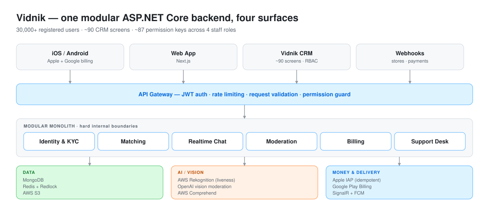

<h1 align="center">Mohannad Alhajy</h1>

  <b>ASP.NET Core Developer · React · Dubai</b>

  <a href="https://mohannad-alhajy.vercel.app">Portfolio</a> ·
  <a href="https://linkedin.com/in/mohannad-alhajy">LinkedIn</a> ·
  <a href="mailto:mohannad.alhajy@gmail.com">Email</a> ·
  <a href="https://mohannad-alhajy.vercel.app/api/resume">Resume</a>

  <picture>
    <source media="(prefers-color-scheme: dark)" srcset="assets/architecture-dark.svg">
    
  </picture>

---

**5+** years experience · **20+** completed projects · **30,000+** users served in production

ASP.NET Core developer with strong React frontend skills — cross-platform payments, multi-tenant SaaS, real-time features.

On the backend, C# and ASP.NET Core: Apple and Google billing that reconciles, one platform serving many companies without leaking data between them, chat and notifications that hold up under load.

On the frontend, React and Next.js: the apps and dashboards that operate them. Based in Dubai, shipping production systems for HR, legal, proptech, and social platforms.

---

## Featured Projects

| Project | What it is |
| --- | --- |
| **[Vidnik](https://mohannad-alhajy.vercel.app/projects/vidnik)** | Halal matchmaking platform — real-time chat, AWS Rekognition liveness checks, an OpenAI vision pipeline for photo moderation, and cross-platform Apple/Google billing. 30,000+ registered users. |
| **[Vidnik CRM](https://mohannad-alhajy.vercel.app/projects/vidnik-crm)** | The operations console behind it — ~90 screens, ~87 granular permission keys across four staff roles, moderation queues, revenue ops, and a support desk. |
| **[Exyar](https://mohannad-alhajy.vercel.app/projects/exyar)** | Luxury car rental platform with an admin dashboard and an AI conversational assistant for discovery and booking. |
| **[PMS](https://mohannad-alhajy.vercel.app/projects/pms)** | Agile project management platform — boards, epics, sprints, approvals, and document management on a modular ASP.NET Core + MongoDB backend. |
| **[Zadlaw](https://mohannad-alhajy.vercel.app/projects/zadlaw)** | Law firm platform for booking consultations, with an admin dashboard for appointments, analytics, and content. |
| **[Axiom](https://mohannad-alhajy.vercel.app/projects/axiom)** | UAE proptech — one modular ASP.NET Core backend serving web, admin, a Unity 3D client (Whisper + AWS Polly voice), and an AI negotiation gateway. |
| **[Save In Gold CRM](https://mohannad-alhajy.vercel.app/projects/save-in-gold-crm)** | Multi-role sales CRM — lead acquisition across app, kiosk, web, and social, with agent assignment and a unified inbox. |
| **[HR Software](https://mohannad-alhajy.vercel.app/projects/hr-software)** | Multi-company workforce management — attendance, tasks, roles, and permissions under a super-admin. |

More at **[mohannad-alhajy.vercel.app/projects](https://mohannad-alhajy.vercel.app/projects)**.

---

## Stack

| | |
| --- | --- |
| **Backend** | C#, ASP.NET Core, Web API, Entity Framework Core, REST / GraphQL, SignalR |
| **Frontend** | TypeScript, React, Next.js, Redux / Zustand, Tailwind CSS |
| **Cloud & DevOps** | AWS (EC2, S3, RDS, Lambda), Docker, CI/CD Pipelines |
| **Databases & Caching** | MySQL, MongoDB, Redis |

Full technology list

**Languages & Runtime** — C#, .NET, TypeScript, JavaScript, SQL, Sass / SCSS

**Backend** — ASP.NET Core, Web API, Minimal APIs, REST APIs, Swagger / OpenAPI, WebSockets, SignalR, LiveKit, JWT, ASP.NET Core Identity, FluentValidation, Rate Limiting

**Databases & Caching** — MongoDB, MySQL, PostgreSQL, SQL Server, Entity Framework Core, Redis, StackExchange.Redis, Redlock

**Frontend** — React, Next.js, Tailwind CSS, Material UI, Radix UI / shadcn, HeroUI, Zustand, Redux, TanStack Query, SWR, React Hook Form, Zod, Framer Motion, GSAP, Three.js, React Three Fiber, Recharts, ApexCharts, Lexical, TipTap, Yjs, Embla / Swiper, i18next

**Cloud & DevOps** — AWS S3, SES, Lambda, SSM, Secrets Manager, Rekognition, Polly, Comprehend, Docker, Docker Compose, Nginx, CI/CD Pipelines, Firebase, Google Cloud Pub/Sub, Google Cloud Speech

**Integrations & Services** — Stripe, QuickBooks, OpenAI, Google OAuth, Apple Sign-In, Google Play Billing, Firebase Cloud Messaging, Microsoft Graph, SMSGlobal, reCAPTCHA, Mapbox, Mixpanel, Sentry, New Relic

**Background Jobs & Observability** — Hangfire, Hosted Services, Serilog, Elasticsearch Logging

**Testing & Tooling** — xUnit, Jest, Cypress, Testing Library, ESLint, Prettier, Storybook, Webpack, Git

---

## Experience

**Full Stack Developer — Step By Tech** · 2021 – Present · Dubai
Built backend services with C# and ASP.NET Core and frontends with React and TypeScript across several product lines — the APIs behind Vidnik (social), Zadlaw (legal), and Exyar (auto), real-time messaging and video calling for mobile-first products, React admin dashboards and internal tooling, and AWS deployments with Docker and Nginx.

**Full Stack Developer — InfoTech** · 2020 – 2021 · Dubai
Built multi-tenancy with full data isolation for enterprise customers, maintained ongoing data integrations, and worked on core systems built for zero-downtime releases.

**Damascus University** · 2015 – 2020 · Syria
BSc, Software and Information Systems Engineering

---

## How I Build

- **I stopped splitting services early.** A modular monolith with hard internal boundaries, split only once a service has its own scaling or failure profile.
- **Money code should be boring and idempotent.** Every payment handler assumes the webhook arrives twice, out of order, and after the user closed the tab.
- **Real-time is a product decision, not a tech one.** Persistent connections for what genuinely changes while you watch; plain requests for the rest.
- **AI writes the first draft, never the last word.** Every line that ships is one I've read and could defend with the chat window closed.

---

  <a href="mailto:mohannad.alhajy@gmail.com">mohannad.alhajy@gmail.com</a>

